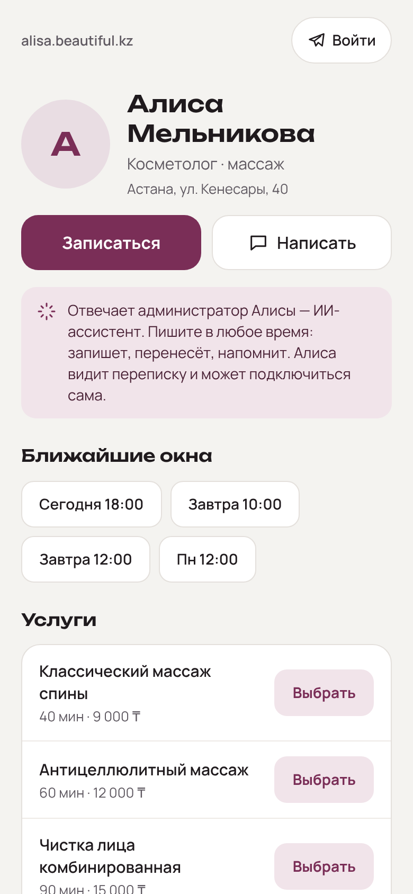
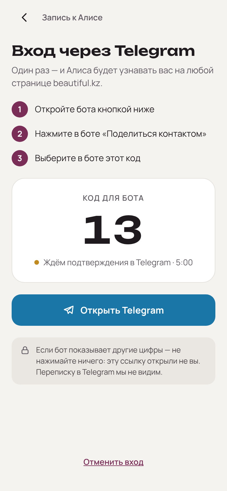
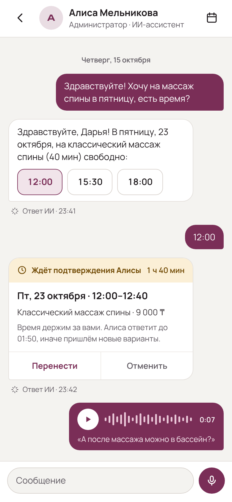
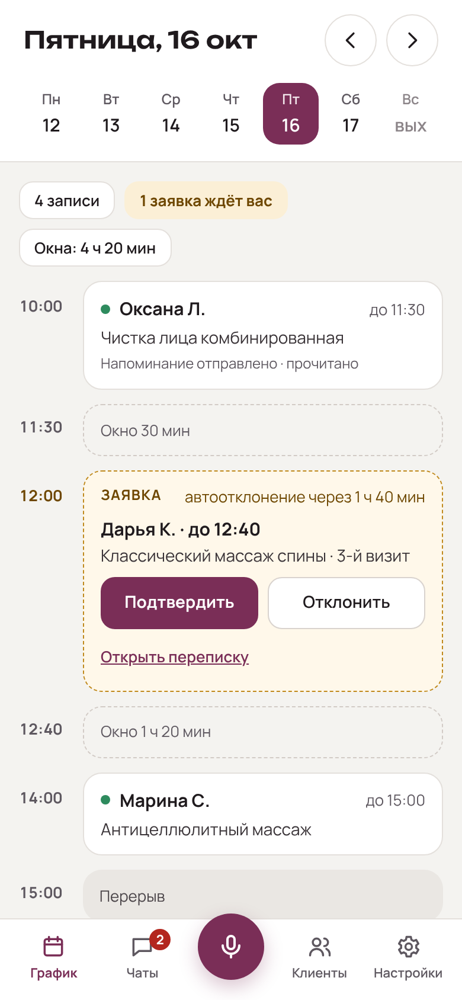
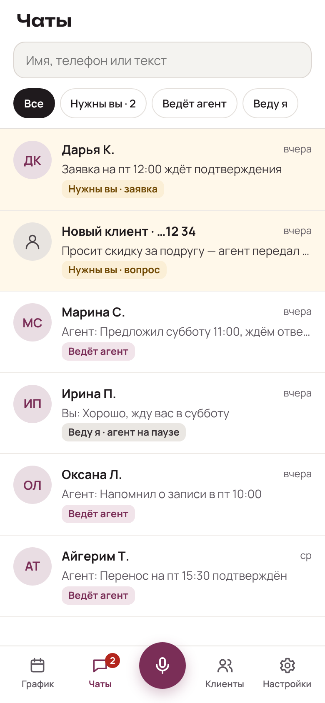
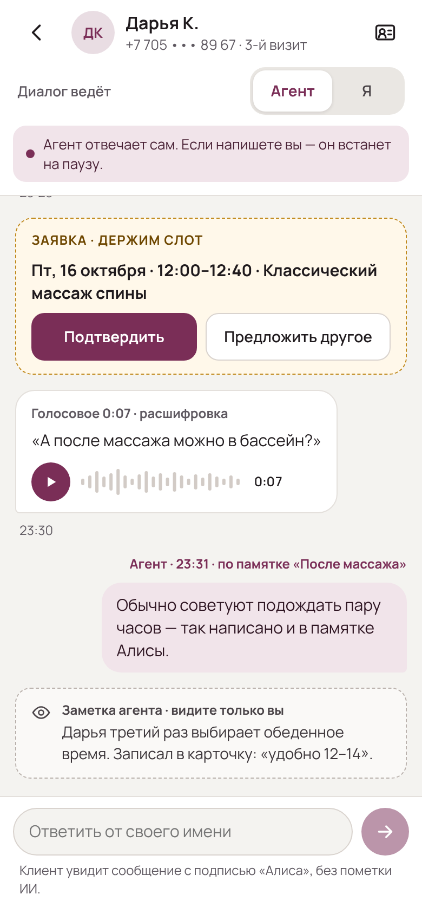
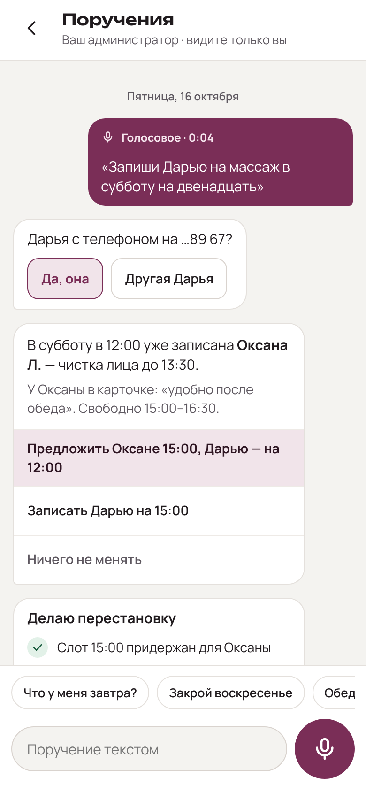

# Фронтенд, итерация 1 — отчёт

ТЗ: `docs/tasks/frontend-iteration-1.md`. Макеты: `docs/design/mockups/`.
Как запускать: `frontend/README.md`.

## Итог по критериям приёмки

| Критерий | Состояние |
|---|---|
| `pnpm -C frontend install && pnpm -C frontend dev` поднимает оба приложения в mock-режиме | ✅ клиент — :5173, мастер — :5174 |
| 7 экранов визуально соответствуют макетам | ✅ скриншоты ниже; отклонения перечислены |
| Вход через Telegram против реального бэкенда из docker compose | ✅ проверено в песочнице без живого бота (см. ниже); с живым ботом — проверить на стенде |
| `contracts/openapi/beauty.yaml` валиден (redocly lint) | ✅ без ошибок и предупреждений |
| Типы `packages/api` сгенерированы из контракта, MSW типизирован ими же | ✅ `contract:check` сверяет типы; расхождение мока с контрактом — ошибка компиляции (проверено) |
| lint, typecheck, unit, e2e зелёные | ✅ ESLint 0 замечаний; tsc без ошибок; Vitest 53/53; Playwright 6/6 |
| `docker compose up` раздаёт обе сборки через nginx | ✅ проверено: host-маршрутизация, SPA-маршруты, SW, прокси `/api` и SSE |

### Как проверен вход против реального бэкенда

В песочнице подняты `postgres`, `rabbitmq`, `migrate`, `api`, `web` из корневого
`docker-compose.yml`. Живого бота нет (нет токена и доступа к Telegram), поэтому
действия бота выполнены теми же командами приложения, которые шлёт бот
(`ClaimChallenge` → `ConfirmChallengeCode` с кодом с экрана →
`CompleteChallengeWithContact`), внутри контейнера `api`. Браузер (Chromium,
`http://alisa.localhost:8080`, real-сборка) при этом прошёл весь путь сам:

```
POST /api/v1/auth/session/refresh                → 401   (гость при старте)
POST /api/v1/auth/telegram/challenges            → 201   (код на экране, cookie bk_auth_challenge)
GET  /api/v1/auth/telegram/challenges/{id}/events → 200  (SSE через nginx)
POST /api/v1/auth/telegram/challenges/{id}/session → 200 (обмен, cookie bk_refresh: httpOnly, path=/api/v1/auth/session)
— переход в чат, запись продолжена; перезагрузка страницы:
POST /api/v1/auth/session/refresh                → 200   (сессия восстановлена)
```

Остаётся прогнать с живым ботом на стенде (`BEAUTY_TELEGRAM__BOT_TOKEN`).

## Скриншоты (e2e, 390×844)

| Клиент | | |
|---|---|---|
|  |  |  |
| Main | ClientLogin | ClientChat |

| Мастер | | | |
|---|---|---|---|
|  |  |  |  |
| MasterSchedule | MasterChats | MasterDialog | MasterAssistant |

Даты в фикстурах строятся от «сегодня» (окна и заявки всегда в будущем), поэтому
дни и время на скриншотах отличаются от макетов (17 октября и т. п.).

## Отклонения от макетов

1. **Карточка заявки у клиента показывает текущий статус.** В макете карточка
   «Ждёт подтверждения» и ниже системное «Алиса подтвердила запись» — снимок истории.
   У нас карточка обновляется по SSE (`message.updated`): после подтверждения её шапка
   становится «Запись подтверждена». В шапку заявки добавлен таймер удержания
   («1 ч 40 мин») — по ТЗ.
2. **Окна в предложении агента после выбора неактивны** (выбранное подсвечено, как в
   макете; остальные выглядят так же, но не нажимаются) — чтобы не создать вторую заявку.
3. **Голосовое клиента в диалоге мастера**: к подписи «Голосовое 0:07 · расшифровка» и
   тексту добавлен плеер — без него мастер не может прослушать оригинал.
4. **Состояния, которых нет в макетах**: скелетоны, пустые списки, ошибки с повтором,
   полоса «нет сети», «Переподключаемся…», «Отправляется…» и «Не отправлено · Повторить»,
   уведомления (toast), листы «Мои записи», «Перенести», «Отменить запись?»,
   «Карточка клиента». Оформлены токенами макетов.
5. **«Мои записи»** (иконка календаря в шапке чата): в макете есть только кнопка. Сделан
   лист со списком активных записей, настройкой уведомлений и выходом из аккаунта.
6. **Клиенты и Настройки мастера** в макете — ссылки-заглушки. «Клиенты» — заглушка,
   «Настройки» — только уведомления (push) по ТЗ.
7. **Напоминание в графике**: «Напоминание отправлено · прочитано» без «вчера» — в
   контракте нет времени отправки напоминания (открытый вопрос 13).
8. **Экран входа без намерения записаться** (кнопка «Войти» на странице) подписан
   «Вход», а не «Запись к Алисе».
9. **Иконка «новый клиент»** (силуэт вместо инициалов) показывается для `visit_number = 1`
   — в контракте нет явного признака «имя неизвестно» (открытый вопрос 10).
10. **Сводка дня в графике** на 390 px может переноситься на вторую строку (в макете —
    одна строка): реальные подписи длиннее («1 заявка ждёт вас», «Окна: 4 ч 20 мин»).
11. **Фото мастера**: в макете буква-аватар; поддержан и `avatar_url`, если он есть.

## Отклонения от ТЗ и технические решения

1. **TypeScript 5.9.3, а не 7.0.** Актуальные typescript-eslint (≤6.0) и
   openapi-typescript (^5) с TS 7 не работают. Остальные зависимости — последние
   стабильные (React 19.3, react-router 8.4, Vite 8.3, TanStack Query 5.104, MSW 3.0,
   Vitest 5, Playwright 1.64, vite-plugin-pwa 2.0), зафиксированы в `pnpm-lock.yaml`.
2. **Моки в странице вместо service worker MSW.** У одного scope может быть только один
   service worker: MSW-worker и PWA-worker несовместимы. Моки подключены как `fetch`
   в `HttpCore` (`getResponse` из MSW по тем же типизированным обработчикам), поэтому
   PWA-worker работает и в сборках с моками. Цена: моки не видны во вкладке Network
   DevTools; состояние моков живёт до перезагрузки страницы (кроме мок-сессии).
3. **Режимы `mock|real` уточнены набором групп** (`VITE_REAL_API`): «реальные
   эндпоинты, где они есть» — это группы контракта, уже реализованные бэкендом (сейчас
   `auth`). Сборка в docker: клиент — `real` с `auth`, мастер — `real` без групп.
   Вход в `mock`-режиме по умолчанию реальный (как в ТЗ); `VITE_MOCK_AUTH=1` мокает и
   его — так работают e2e и разработка без бэкенда.
4. **Дополнительный пакет `packages/pwa`** (service worker, регистрация, подписка на push) —
   общий код двух приложений.
5. **Порты сверх перечисленных в ТЗ**: `InboxGateway` (чаты мастера), `AssistantGateway`
   (поручения), `MasterEventsGateway` (`/me/events`), `PushGateway`. `ConversationGateway`
   — переписка клиента.
6. **Одна SSE-подписка на кабинет мастера**: события `/me/events` патчат кэш TanStack Query
   (график, чаты) и раздаются лентам (диалоги, поручения) через хаб.
7. **SSE читается через `fetch`, а не `EventSource`** — чтобы передавать
   `Authorization` и переживать refresh токена; переподключение с `Last-Event-ID` и
   экспоненциальной паузой. Вход: при обрыве SSE включается опрос `GET` раз в 3 с.
8. **Ошибки identity** на момент итерации были не RFC 9457, а
   `{"error": {"code", "message"}}`; `ApiError` понимает оба формата. С бэкенд-итерации 1
   все эндпоинты отдают problem+json, `ErrorEnvelope` из контракта убран.
9. **Кэш данных в service worker** — network-first для `GET /api/v1/*` (кроме входа и SSE),
   при выходе кэш очищается. Шрифты — только кириллица и латиница.
10. **Отсчёт автоотклонения** тикает локально каждые 15 с (график) / 30 с (карточка
    клиента); по истечении срока график перечитывается с сервера, события
    `appointment.updated` приходят по SSE.

## Дополнения к контракту

Сверх перечисленного в ТЗ (всё — в `contracts/openapi/beauty.yaml`):

* `book_slot` — сообщение клиента «хочу это окно» (продолжение записи после входа, когда
  окно выбрано на странице до входа; `slot_pick` требует предложения агента);
* `MasterPage.name_forms` — имя мастера в падежах для текстов («Запись к **Алисе**»,
  «подтверждения **Алисы**»);
* `GET /me` — профиль мастера (часовой пояс, имя для подписи «Клиент увидит сообщение
  с подписью «Алиса»»);
* `GET /me/conversations/{id}` — шапка диалога;
* `decline.offer_alternatives` — «Предложить другое» из карточки заявки;
* `MasterSendResult.handler` — ответ мастера сообщает, кто теперь ведёт диалог;
* `webhooks.pushNotification` / `PushPayload` — полезная нагрузка Web Push.

## Открытые вопросы к контракту API

Вопросы 1–4 решены — см. `docs/tasks/backend-iteration-1-tenancy.md`, раздел 0
(problem+json везде; SSE принимает Bearer; журнал `Last-Event-ID` 24 ч и `event: reset`;
SSO через `BEAUTY_AUTH__COOKIE_DOMAIN=.beautiful.kz`). Вопросы 7 (голосовые — подписанные
ссылки), 11 (занятое окно — 201 и новое `slot_offer`) и 16 (`hold_until` = `auto_decline_at`)
решены в `docs/tasks/backend-iteration-2-booking.md`, раздел 0. Вопросы 5 (роль мастера —
телефон владельца страницы, 403 `not_a_master`) и 14 (непрочитанное сбрасывает чтение
истории) — в `docs/tasks/backend-iteration-3-master-cabinet.md`.

1. **Формат ошибок identity**: переводим на problem+json (тогда `ErrorEnvelope` уходит из
   контракта) или оставляем?
2. **SSE с Bearer**: бэкенд должен принимать `Authorization` на `/events` (браузерный
   `EventSource` заголовки не умеет; мы читаем поток через `fetch`). Альтернатива —
   короткоживущий токен в query.
3. **`Last-Event-ID`**: сколько событий хранить для досылки и что отвечать, если id
   устарел? Предлагаем событие `reset` — клиент перечитывает историю.
4. **SSO между поддоменами**: `bk_refresh` с `Domain=.beautiful.kz` (настройка
   `BEAUTY_AUTH__COOKIE_DOMAIN`) — один вход на все страницы мастеров и кабинет.
   Подтвердить для прода.
5. **Роль мастера** (tenancy): как кабинет узнаёт, что аккаунт — мастер; `GET /me` для
   клиента — 403? Отдельный вход мастера или тот же Telegram?
6. **Манифест PWA по мастеру**: имя и иконка «Алиса Мельникова» на `alisa.beautiful.kz`
   требуют динамического `/manifest.webmanifest` (бэкенд или nginx). Сейчас манифест общий.
7. **Медиа**: `audio_url` и фото — подписанные URL? Срок жизни, CDN, кэширование в SW.
8. **Голосовые**: форматы `audio/webm;codecs=opus` и `audio/mp4` (iOS Safari), лимиты
   2 мин / 5 МБ — подтвердить; расшифровка приходит позже через `message.updated`.
9. **Часовой пояс**: всё время в интерфейсе — в поясе мастера (`MasterPage.timezone`),
   `DaySchedule.date` — локальная дата мастера. Подтвердить.
10. **Неизвестное имя клиента**: нужен явный признак (сейчас `display_name` вида
    «Новый клиент · …12 34» и `visit_number = 1`).
11. **Окно заняли, пока клиент выбирал**: `slot_pick` → 409 и новое `slot_offer` по SSE?
12. **Push**: отписка при выходе (`DELETE /push/subscriptions/{id}` — id храним на
    устройстве), локализация и группировка (`tag`), откуда берётся VAPID-ключ на стенде.
13. **Напоминания**: время отправки и прочтения (`reminder_sent_at`), чтобы показать
    «отправлено вчера».
14. **Непрочитанное**: как сбрасывается `unread` — нужен явный `POST /me/conversations/{id}/read`
    (в моках сбрасывается при чтении истории).
15. **Идемпотентность по `client_id`**: сколько сервер помнит `client_id` для повторов.
16. **Автоотклонение**: `hold_until` и `auto_decline_at` всегда совпадают? Если да — оставить
    одно поле.
